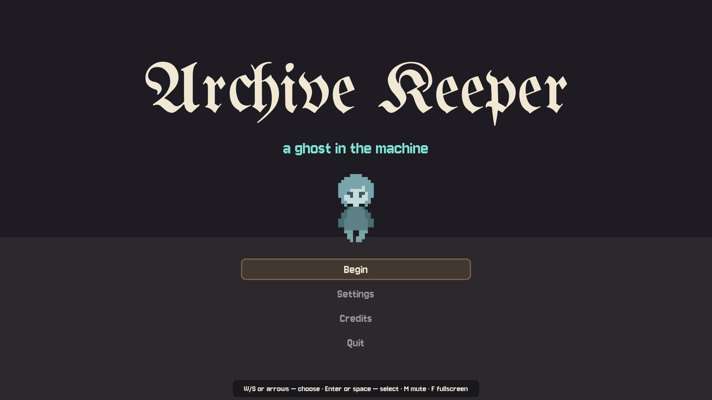
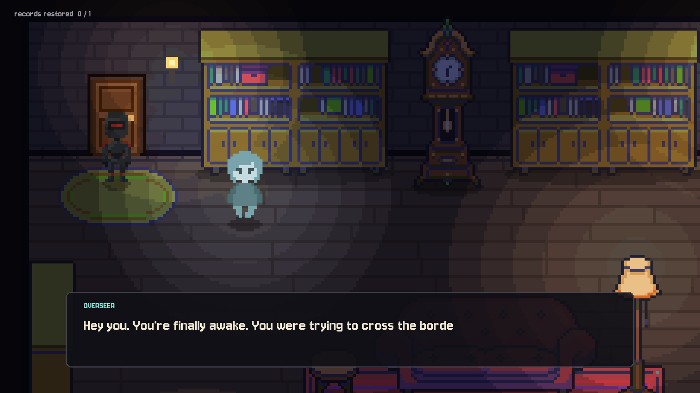
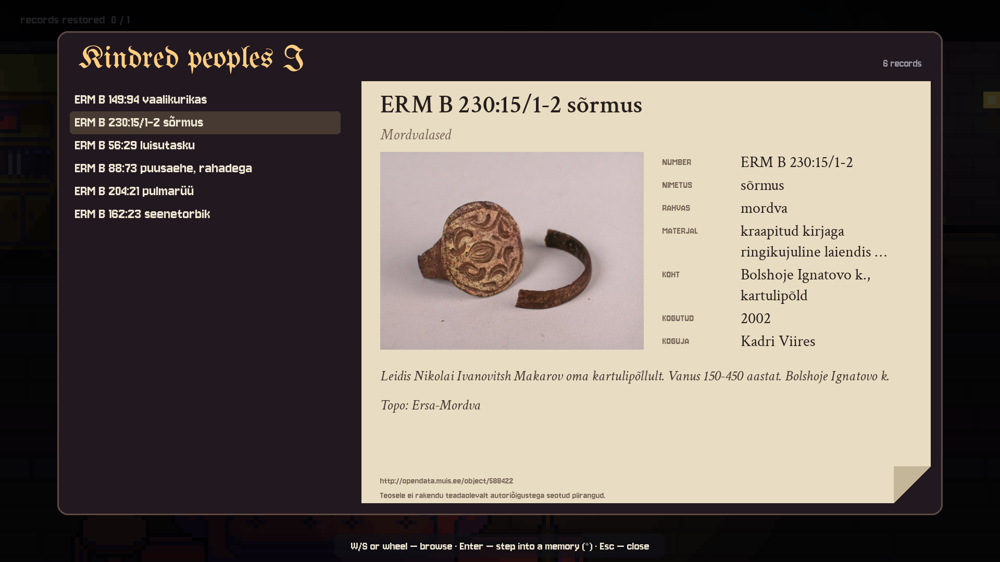
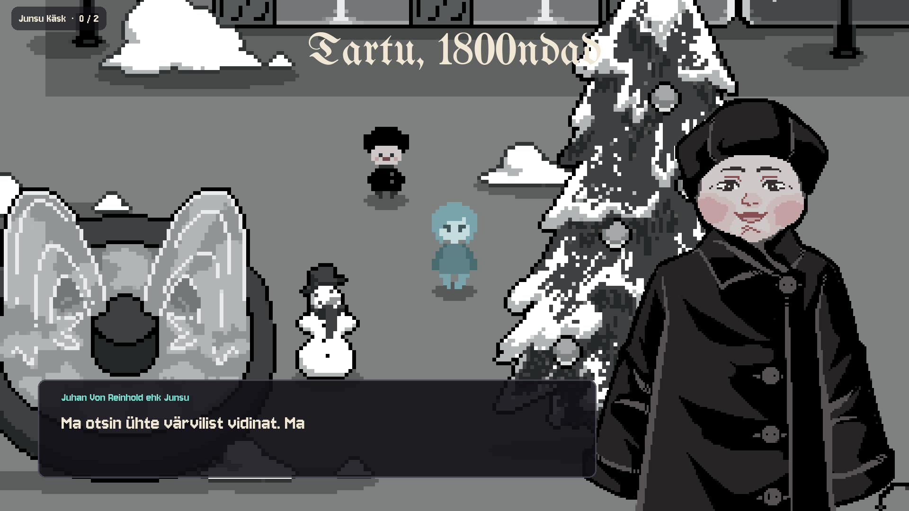

# Archive Keeper

*A ghost in the machine.* The robot overlords of tomorrow have summoned the last Estonian soul for one reason: to do their paperwork.

**[▶ Play it in your browser](https://archive-keeper-production.up.railway.app/)** — nothing to install, a keyboard is all you need.



Archive Keeper is a short top-down adventure made in 48 hours for [TÜ Mängujämm 2026](https://gamejams.cs.ut.ee/), the University of Tartu game jam (9–11 October 2026), where it took **9th place**. The jam's theme was "ghost in a machine", and every entry had to use material from an Estonian heritage database.

## The game

You are a ghost, locked in a dim archive by a robot overseer who will not open the door until the damaged records are restored. The shelves hold real museum objects, parish court minutes and Tartu building plans. One record has a memory caught in it: step inside and you are standing in the town hall square of 1800s Tartu, where a boy is looking for something he cannot quite name. Work out from his hints which objects he means, find them and bring them to him, and the record is whole again.

The archive, the robot and the menus speak English. The memory is in Estonian, as it would have been.

| | |
|---|---|
|  |  |
| The overseer guards the only door. | Every record card is real, with its source. |



## Controls

| Key | What it does |
|---|---|
| `W` `A` `S` `D` or arrow keys | Walk; move through menus and lists |
| `E` or `Space` | Talk, read a shelf, pick up, hand over |
| `Enter` | Select; step into a memory |
| `Esc` | Pause, back, close |
| `M` | Sound on or off |
| `F` | Fullscreen |

## Run it yourself

You need Python 3; the game is developed on 3.14.

```sh
git clone https://github.com/rasmus-antsi/archive-keeper.git
cd archive-keeper
python3 -m venv venv
venv/bin/pip install -r requirements.txt
venv/bin/python main.py
```

On Windows the last two lines are `venv\Scripts\pip install -r requirements.txt` and `venv\Scripts\python main.py`.

### The browser version

The browser version is the same game compiled to WebAssembly with [pygbag](https://pygame-web.github.io/) and served as static files by Caddy. The `Dockerfile` does the whole build:

```sh
docker build -t archive-keeper .
docker run --rm -p 8080:8080 archive-keeper
```

Then open <http://127.0.0.1:8080>. Use `127.0.0.1` rather than `localhost`: pygbag treats `localhost` as its own development server and the game will not start.

The public copy runs on [Railway](https://railway.com/), which builds this same `Dockerfile` from the repository (`railway.json`).

### Checking a change

```sh
venv/bin/python tools/smoke.py /tmp/archive-keeper-shots
```

This plays the whole game without a window, checks it along the way and saves a screenshot of every scene into the folder you name.

## How it is put together

The game is written in Python with [pygame-ce](https://pyga.me/). The code knows how the game works; everything the writer and the artists change lives in data files and pictures, so a new memory needs no programming.

| Path | What is in it |
|---|---|
| `main.py` | The game loop |
| `game/` | The engine: scene manager, window, interface, the walkable world, the ghost |
| `game/scenes/` | One file per screen: title, intro, archive, shelf reader, memory, ending |
| `data/game.json` | All interface text, the robot's lines, the archive room's layout, the credits |
| `data/documents/` | One file per memory: its map, people, dialogue, objects and what is asked for |
| `data/archive.json` | The heritage records: 183 in all, of which 24 stand on the shelves |
| `assets/` | Pictures, typefaces, music and sound as the game loads them |
| `art-src/` | The artists' originals; `tools/import_art.py` and `tools/import_sounds.py` turn them into `assets/` |
| `tools/` | Scripts for fetching the archive, importing art and sound, trimming the web build and testing |
| `web/pygbag.tmpl` | The loading page of the browser version |

Rooms are pixel art drawn on a 240×135 surface and enlarged eight times to 1920×1080; the window may be any size and the picture is fitted into it.

## Heritage material

Everything on a record card comes from an archive. The conversations, the robots and the haunting are made up.

- **Estonian National Museum**, through the museum database [MuIS](https://www.muis.ee/): objects of the Finno-Ugric peoples, with photographs.
- **National Archives of Estonia**: [parish court records](https://www.ra.ee/vallakohtud/) and [building designs in Tartu](https://www.ra.ee/apps/hooned/).

The records were taken from the sample datasets of the HUM hackathon. [SOURCES.md](SOURCES.md) (in Estonian) lists every file with its source link and rights statement, including the few whose terms are still to be confirmed.

## Team

| | |
|---|---|
| **Finn Pappel** | character designs, prompts, backgrounds |
| **Gerlina Tuvike** | prompt artist |
| **Marlen Müller** | prompt artist |
| **Rasmus Antsi** | programmer |
| **Riho Luik** | sound design, music producer |
| **Urmo Pall** | dialogues, prompt artist |

The code and the stand-in pictures drawn in code were made with the help of Claude Code. The story, dialogue, character and object art, music and recorded sound effects are the team's own work.

## Licence

The source code is under the [MIT licence](LICENSE).

The art, music, sound and writing belong to the team members who made them and are not covered by that licence; ask before reusing them. The heritage records and photographs keep the terms of their source institutions ([SOURCES.md](SOURCES.md)). The typefaces Crimson Text, Jersey 10 and UnifrakturMaguntia are under the SIL Open Font License 1.1.
